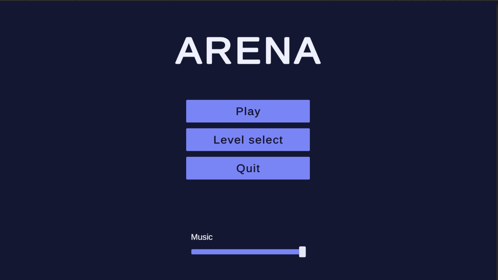
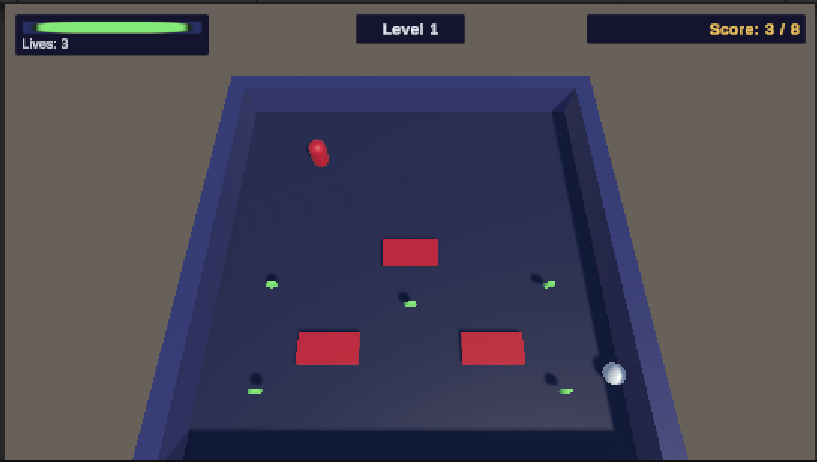
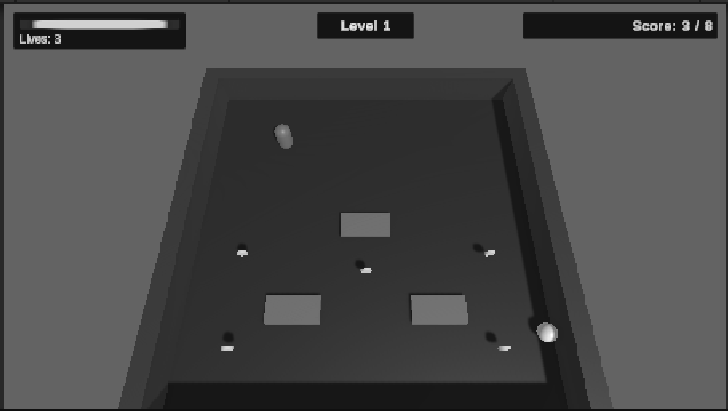

# CS464 Assignment 04 · Abdullah · BSCS25017

**Video (90-180 s):** https://drive.google.com/file/d/1kvnASCEB8SEGen-BRFZv4a4aGOGpReRS/view?usp=drive_link

Started from my Assignment 03 repo (history kept). HUD, pause, win and game-over screens are one prefab used in all five levels.

## Settings
| Part | Setting | Value | Why |
|---|---|---|---|
| A | Harmony · base hue | triadic · 234° | blue-violet base, hazard 350°, pickup 114° |
| A | Dark · mid · light | #141733 · #7F8BFF · #EEF0FF | panel, player/buttons, text |
| A | Accents | #C81E3A · #88F27C | hazards, pickups (differ in luminance 0.14 vs 0.70) |
| A | Score text on its panel | 12.14 : 1 | gold #FFD166 on #141733 |
| A | Button label on the button | 5.87 : 1 | dark label; white would be about 3.0 |
| B | Music · SFX groups, as mixed | 0 dB (source 0.5) · 0 dB | music sits under effects |
| B | Slider at 1 · 0.5 · 0.0001 | 0 · -6.02 · -80 dB | Log10(v) x 20 |
| C | Guard hum, in Level 1 | Logarithmic · Min 2 · Max 25 | guard is ~1 m wide so Min 2 keeps it full volume only when close; 25 m is where the arena ends |
| C | Power-up shimmer, in Level 1 | Linear · Min 1 · Max 15 | a short-range cue that fades to silent so you hunt it by ear |
| C | AudioListener | on the player (ListenerOnPlayer), camera is 19-30 m away |  A far top-down camera hears nothing spatial, so the listener follows the player. |
| D | unlocked | int · default 1 | only level 1 open on a fresh save |
| D | best1 … best5 | float · HasKey first | a missing time must not read as 0.0 |
| D | MusicVolume | float · default 1 | full volume until changed |

## Answers
1. **What `Time.timeScale = 0` stops in my game, and what it doesn't:** It freezes physics (FixedUpdate), guard movement, chaser movement, crushers, the level timer, respawn coroutines and Time.time based invulnerability.It does not stop Update, so PlayerController checks PauseMenu.IsPaused before reading input.The lag bar and damage flash use unscaled time and music and effects ignore the pause.World sounds stop through AudioListener.pause.

2. **What survives a LoadScene in my game, and how:** SfxPlayer and PersistentMusic stay alive through DontDestroyOnLoad,. Only if a singleton check makes sure there is just one instance. That way, there is never a music player running. PlayerPrefs stays saved on disk, so settings and data persist between loads. Static values like Time.timeScale, AudioListener.pause and PauseMenu.IsPaused also survive. Because of this, the Resume() function runs before every scene load. The LevelLoader resets time after that. The HUD, GameManager and LevelLoader are rebuilt each time a level loads.

3. **Why every PlayerPrefs read in my game has a default:** When you clear all PlayerPrefs or start from a clone, there is no key at all. GetInt with no default gives back 0. So nothing would be unlocked.. A missing best time would show up as 0.0 s, a record you could never beat. With defaults you get "unlocked 1" and "volume 1".. Haskey is what decides if a best time is there at all.

4. **An exception a forgotten unsubscribe would throw, and why mine can't:** A static or surviving event might call a destroyed HealthBarBinder, which would throw a MissingReferenceException when it tries to touch its bar after a restart. My events are instance-based on Health and every += in OnEnable has a -= in OnDisable. That cleanup runs when the scene unloads, so no subscriptions remain after the scene is gone.